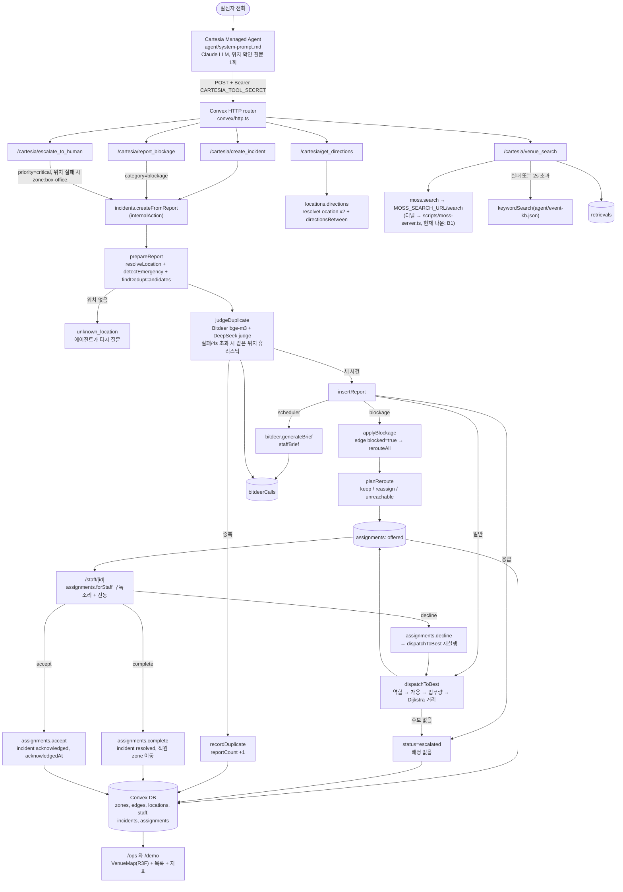

# PeopleOS 파이프라인 점검

점검 시각: 2026-10-25 01:00–01:20 PT · 대상 배포: `resolute-horse-290` · 브랜치 `claude/peopleos-pipeline-audit-40c15e` (8e9f3ba).
점검만 했고 코드는 수정하지 않았습니다. 키와 시크릿 값은 이 문서에 없습니다.

## 요약: 끊어지거나 위험한 지점

### 깨짐
| # | 지점 | 근거 | 영향 |
|---|---|---|---|
| B1 | **Moss 검색 서버 터널 다운** | `MOSS_SEARCH_URL`은 localhost.run(`*.lhr.life`) 주소. 직접 `POST /search` → `502 no tunnel`. `/cartesia/venue_search`는 `outcome:"fallback"`(42 ms)으로 응답 | 전화 답변은 계속 나옴(`agent/event-kb.json` 키워드 매칭). 다만 Moss가 실제로 쓰이지 않아 Moss 트랙 시연 불가. 터널 URL은 재시작할 때마다 바뀌므로 `npx convex env set MOSS_SEARCH_URL ...`도 다시 해야 함 |
| B4 | **웹/SMS 대체 신고 UI 없음** | `incidents.reportFromWeb` action은 있지만 이를 호출하는 화면이 어디에도 없음(`useAction` 사용처 0) | CLAUDE.md의 "SMS/web-call fallback" 필수 항목이 미완성. 전화가 죽으면 신고 경로가 없음 |

### 수정됨 (이 점검 직후)
| # | 지점 | 수정 | 검증 |
|---|---|---|---|
| B2 | Bitdeer 직원 브리프 실패 | `DeepSeek-V4.1-Flash`가 reasoning에 180–350 토큰을 써서 `max_tokens: 200`에서 답이 비었음. `BRIEF_MAX_TOKENS = 1000`으로 상향 (`convex/lib/bitdeer.ts`) | 라이브 테스트 사건에서 `staffBrief` 저장됨, `bitdeerCalls` brief `ok:true`(4.6 s, 10 s 제한 안) |
| B3 | 완료한 사건의 마커가 초록이 아니라 사라짐 | (변경됨) 데모 요청으로 완료된 사건은 마커가 바로 사라지도록 되돌림: `incidents.listActive`는 활성 사건만 반환 | 라이브에서 accept → complete 후 `listActive`에 `status:"resolved"`로 포함됨. 3D 화면 렌더링은 눈으로 확인하지 않음 |

### 확인됨 (동작을 코드 + 실호출로 확인)
| # | 지점 | 동작 |
|---|---|---|
| C1 | `/health` | `200 ok` |
| C2 | Cartesia 웹훅 인증 | `CARTESIA_TOOL_SECRET` 설정됨. 헤더 없이 호출 → `401 unauthorized` |
| C3 | `create_incident` 전체 경로 | "Luggage Room / lost_found" 테스트 → `outcome:"created"`, Theo Park(guest_services)에게 `offered` 배정. 이후 `incidents:cancel`로 정리: 사건 `cancelled`, 배정 `cancelled`, Theo `available`, 활성 사건 0건 |
| C4 | `get_directions` | Table 142 → Box Office 경로 문장 정상 반환. 막힌 edge는 `buildGraph`에서 제외되므로 길 안내도 막힘을 피함 |
| C5 | 터널이 죽으면 | `venue_search`는 2 s 제한(`MOSS_TIMEOUT_MS`) 후 키워드 fallback, 절대 실패하지 않음. `retrievals`에 `fallback`으로 기록되고 `/ops`에 fallback 수가 보임 (B1에서 실제로 확인) |
| C6 | decline 후 다음 후보가 없을 때 | `assignments.decline` → `dispatchToBest`가 후보를 못 찾으면 사건을 `escalated`("No eligible staff available or reachable")로 바꿈. 거절한 직원은 같은 사건에서 제외(`declinedFor`). 사건은 대시보드에 빨간 마커로 남음 |
| C7 | 전화 AI가 사건 상태를 아는가 | **모름.** 도구 5개(`create_incident`, `report_blockage`, `escalate_to_human`, `get_directions`, `venue_search`) 중 상태 조회가 없음. 생성 시점의 `message`만 받음. "제 신고 처리됐나요?"에는 답할 수 없음 |
| C8 | 응급 규칙 | 프롬프트(에이전트가 `escalate_to_human` 호출) + 서버(`detectEmergency` 키워드/카테고리 → `escalated`, 배정 없음, dedup 제외) 이중 방어. `escalate_to_human`은 위치를 못 찾아도 `zone:box-office`로 반드시 생성(실제로 resolve 확인) |
| C9 | Bitdeer dedup | 최근 `embedding`/`judge` 기록 모두 `ok:true`(00:02 PT). 키 없음/실패/4 s 초과 시 같은 테이블·부스 휴리스틱으로 fallback |
| C10 | 정적 검사 | `npm run typecheck` 통과, `npm run lint` 통과, `npm test` 9 파일 122 테스트 통과 |

### 확인 안 됨 / 위험 (코드로만 판단, 실호출 안 함)
| # | 지점 | 내용 |
|---|---|---|
| U1 | Cartesia 쪽 설정 | `agent/cartesia-tools.json` URL은 모두 `resolute-horse-290.convex.site/cartesia/*`. Cartesia 대시보드에 등록된 도구가 같은 URL·같은 시크릿인지, 전화번호 연결이 살아 있는지는 여기서 확인 불가. 실제 전화 1통으로 확인 필요 |
| U2 | 응답 없는 배정 | `offered` 상태로 아무도 응답하지 않으면 영원히 그대로. 타임아웃 재배정(scheduler) 없음 |
| U3 | 응급/에스컬레이션 알림 | `escalated` 사건은 ops_lead(Alex Morgan)에게 배정되지 않음. 대시보드 빨간 마커 외에 폰 알림 없음. 운영자가 `/ops`를 보고 있어야 함 |
| U4 | 바쁜 직원은 후보에서 아예 제외 | `rankCandidates`는 `status === "available"`만 봄. accepted 작업이 있으면 `busy`라 업무량 비교 대상이 아님. facilities는 Priya, Jordan 2명(Sam은 off_duty)이라 둘 다 바쁘면 바로 `escalated` |
| U5 | 막힘은 운영자 확인 없이 즉시 적용 | `applyBlockage`가 그 zone에 닿는 모든 edge를 즉시 막음(`pending_review` 상태는 미사용). 잘못된 신고는 `/ops` 배너의 Undo(`blockages.undo`)로만 되돌림. 막힌 zone 안의 사건은 도달 불가 → `escalated` |
| U6 | 인증 없는 공개 mutation | `assignments.accept/decline/complete`, `incidents.cancel`, `blockages.undo/clear`, `staff.setStatus/moveTo`는 인증 없음. 입구의 운영자 암호(`NEXT_PUBLIC_OPS_PASSCODE`, 기본값 있음)는 클라이언트 측 localStorage 게이트일 뿐 |
| U7 | Moss 서버 토큰 | `.env.local`에 `MOSS_SEARCH_TOKEN`이 없음. 이 상태로 `scripts/moss-server.ts`를 띄우면 토큰 검사 없이 열림(`isBearerAuthorized`는 토큰 없으면 통과). Convex에는 설정돼 있어 헤더는 보냄 |
| U8 | 직원 폰 소리 | `useAssignmentAlert`는 화면을 한 번 탭해야 소리가 남(브라우저 정책). 진동은 iOS Safari 미지원 |

## 전체 흐름

## 단계별 입력 → 처리 → 출력

### 1. 전화 → Cartesia → Convex HTTP

| 단계 | 위치 | 입력 | 처리 | 출력 |
|---|---|---|---|---|
| 에이전트 | Cartesia Managed Agent, 지시문 `agent/system-prompt.md` (생성: `agent/prompt.ts`, `agent/export.ts`) | 발신자 음성 | 응급이면 즉시 `escalate_to_human`. 일반 신고는 고정 위치 어휘에서 하나 고르고 확인 질문 1회. 막힘은 `report_blockage`, 길은 `get_directions`, 행사 질문은 `venue_search`, "어디 있어요"는 프롬프트 안 venue guide로 직접 답변 | 웹훅 POST. 본문은 `agent/tools.ts`의 `request_body_schema` 필드 + `call_id`(`{{system__conversation_id}}`) |
| 도구 정의 | `agent/tools.ts` → `agent/cartesia-tools.json` | `TOOLS` 5개 | `toCartesiaWebhookTool`: `execution_mode:"immediate"`, `response_timeout_secs:15`, bearer 인증 | Cartesia `POST /v1/agents/tools` 본문 |
| 라우터 | `convex/http.ts` | HTTPS 요청 | `GET /health`, `POST /cartesia/{create_incident, report_blockage, escalate_to_human, get_directions, venue_search}` | `convex/cartesia.ts` 핸들러로 전달 |
| 공통 래퍼 | `toolHandler` (`convex/cartesia.ts`) | 요청 헤더/본문 | `isAuthorized`(시크릿 없으면 전부 허용) → `parseToolCall`(필수값 검사, category/priority 정규화, 모르면 `other`/`medium`) | `401`, `400`, 업무 결과는 항상 `200 {ok, outcome, message, incidentId}`, 예외는 `500` + "가까운 스태프에게" 문구 |

### 2. 사건 생성 파이프라인 (`incidents.createFromReport` → `runReport`)

| 단계 | 위치 | 입력 | 처리 | 출력 |
|---|---|---|---|---|
| 진입 | `createIncident` / `reportBlockage` / `escalateToHuman` (`convex/cartesia.ts`) | 파싱된 도구 인자 | blockage는 `category:"blockage", priority:"high"`. escalate는 `priority:"critical"`, 카테고리는 정규식(MEDICAL/SAFETY)으로 추정, 위치 실패 시 `zone:box-office`로 재시도 후 `incidents.escalate` | `internal.incidents.createFromReport` 호출 |
| 위치 매칭 | `resolveLocation` (`convex/locations.ts`) | 발신자 문자열 | key(`table:142`) → 테이블 번호 정규식 → label 정확 일치 → alias → 부스 이름 → `search_text` 검색 인덱스. 여러 zone에 걸치면 null(모호) | `locations` 행 또는 null(`unknown_location`) |
| 응급 판정 | `detectEmergency` (`convex/lib/emergency.ts`) | category, description, transcript | `medical`/`safety` 카테고리 또는 키워드(단어 경계, 부정문도 응급 처리) | `matched[]` (비어 있지 않으면 응급) |
| 중복 후보 | `findDedupCandidates` (`convex/dedup.ts`, `convex/lib/dedup.ts`) | zoneId, category, now | `by_zone_category` 인덱스, 활성 상태, `lastReportedAt` 15분 이내, 최대 5건. 응급이면 건너뜀 | `DedupCandidate[]` (`sameLocation` 포함) |
| 중복 판정 | `judgeDuplicate` (`convex/dedup.ts`) + `judgeDuplicateWithBitdeer` (`convex/lib/bitdeer.ts`) | 새 설명 + 후보 | Bitdeer `BAAI/bge-m3` 임베딩 코사인 순위 → 0.55 이상이면 1등만 `DeepSeek-V4.1-Flash` JSON 판정. 예산 3 s, 전체 상한 4 s. 키 없음/실패/시간 초과 → `sameLocationDuplicate` | 중복 incidentId 또는 null. 호출 기록은 `bitdeerCalls` |
| 중복 기록 | `recordDuplicate` | incidentId | `reportCount + 1`, `lastReportedAt` 갱신 | `outcome:"duplicate"` 메시지 |
| 새 사건 | `insertReport` | 인자 + locationId + emergency | `incidents` insert(응급이면 `escalated`/`critical`). `scheduler.runAfter(0, bitdeer.generateBrief)` | 응급 → `escalated`. blockage → 3단계. 그 외 → 4단계 |
| 직원 브리프 | `bitdeer.generateBrief` → `buildStaffBrief` | incident | 통화 밖에서 1회 chat 호출, 12단어 이하로 정리, 10 s 제한 | `incidents.staffBrief` (실패 시 저장 안 함) |

### 3. 막힘 처리 (`convex/blockages.ts`)

| 단계 | 입력 | 처리 | 출력 |
|---|---|---|---|
| `applyBlockage` | blockage 사건 | 사건 zone에 닿는 edge(`by_from`, `by_to`)를 `blocked:true, blockedByIncidentId`로 → `rerouteAll` | 사건 `acknowledged` + `reroutedCount`. 에이전트에 "N tasks being routed around it" |
| `rerouteAll` / `planReroute` (`convex/dispatch.ts`, `convex/lib/dispatch.ts`) | 열린 배정 전체(오래된 순), 새 그래프 | 현재 담당자는 자기 작업을 뺀 업무량으로 경쟁. 더 나은 사람이 있으면 reassign, 아무도 못 가면 unreachable | keep: route 갱신. reassign: 옛 배정 `superseded`, 새 `offered`. unreachable: 배정 `cancelled`, 사건 `escalated` |
| `blockages.undo` / `clear` | `/ops` 배너 버튼 | 이 막힘이 닫은 edge만 다시 열고 `rerouteAll` | 사건 `cancelled`/`resolved` |
| `blockages.listApplied` | - | `acknowledged` 상태의 blockage | `/ops` `BlockageBanner` |

### 4. 자동 배정과 직원 응답

| 단계 | 위치 | 입력 | 처리 | 출력 |
|---|---|---|---|---|
| 순위 | `rankCandidates` (`convex/lib/dispatch.ts`) | incident, staff, workloads, declinedBy, graph | ① 역할: `CATEGORY_ROLE` ② 가용: `status==="available"`, 이 사건을 거절한 사람 제외 ③ 업무량: offered+accepted 수 오름차순 ④ 거리: 사건 zone에서 Dijkstra 1회(`routesFrom`, 막힌 edge 제외), 도달 불가 제외 | 정렬된 `Candidate[]` |
| 배정 | `dispatchToBest` (`convex/dispatch.ts`) | 1등 후보 | 없으면 사건 `escalated` | `assignments` insert(`offered`, `route`), 사건 `assigned`, `assigneeId` |
| 수락 | `assignments.accept` | assignmentId(`offered`여야 함) | 배정 `accepted`, 사건 `acknowledged`, 첫 `acknowledgedAt` 유지, `syncStaffStatus` → `busy` | 지표 avg time-to-acknowledge |
| 거절 | `assignments.decline` | assignmentId(`offered`) | 배정 `declined`, 사건 `open` → `dispatchToBest` 재실행 | 다음 후보에게 `offered`, 없으면 `escalated` (C6) |
| 완료 | `assignments.complete` | assignmentId(`accepted`) | 배정 `completed`, 사건 `resolved`/`resolvedAt`, 직원 zone을 사건 zone으로, `available` | 사건은 `listActive`에서 바로 빠져 마커가 사라짐 |
| 취소/에스컬레이션 | `incidents.cancel`, `incidents.escalate` | incidentId | `cancelOpenAssignments` 후 상태 변경 | 직원 해제 |

### 5. 길 안내와 venue_search

| 단계 | 위치 | 입력 | 처리 | 출력 |
|---|---|---|---|---|
| `get_directions` | `getDirections` → `locations.directions` | `from`, `to` | 둘 다 `resolveLocation`, `directionsBetween`(`convex/lib/directions.ts`, 막힌 edge 제외, 우회 여부 표시), 1.3 m/s 도보 시간 | `directions` / `no_route` / `unknown_location` 메시지. DB 쓰기 없음 |
| `venue_search` | `venueSearch` (`convex/cartesia.ts`) | `query` | `moss.search`를 2 s로 감쌈 | `{outcome: found/no_match/fallback, message, latencyMs}` + `retrievals.record` |
| Moss 호출 | `moss.search` (`convex/moss.ts`) | query | `POST ${MOSS_SEARCH_URL}/search`, `Authorization: Bearer MOSS_SEARCH_TOKEN` | facts top 3 |
| 검색 서버 | `scripts/moss-server.ts` (로컬 :8787) + 터널(localhost.run 또는 cloudflared) | HTTP 요청 | `calhacks-venue` 인덱스를 메모리에 올려 hybrid 검색. 인덱스 생성은 `scripts/moss-index.ts` | `{facts, queryMs}` |
| fallback | `keywordSearch` (`agent/venue-search.ts`) | query + `agent/event-kb.json` | 키워드 점수 | facts. `buildMessage`가 시간 민감 정보에 "as of" 추가 |

## 프런트엔드: 구독하는 Convex 함수

모든 훅은 `components/ui/hooks.ts`. `NEXT_PUBLIC_UI_MOCK=1`이면 Convex 대신 `components/ui/mock.ts` 사용(`components/ui/live.ts`).

| 화면 | query 구독 | mutation | 비고 |
|---|---|---|---|
| `/` (`app/page.tsx`) | `staff.list` | - | 직원 카드 + 운영자(암호) 선택, localStorage에 신원 저장(`components/ui/identity.ts`) |
| `/ops` (`app/ops/OpsView.tsx`) | `zones.graph`, `staff.list`, `incidents.listActive`, `incidents.get`(선택 시), `assignments.listActive`(VenueMap), `incidents.stats` + `retrievals.stats` + `bitdeer.stats`(MetricsBar), `blockages.listApplied` | `blockages.undo` | 사건 목록, 상세, 직원 패널, 지표 |
| `/staff/[id]` (`components/staff/StaffView.tsx`) | `staff.get`, `assignments.forStaff` | `assignments.accept/decline/complete` | 새 `offered` 배정 id가 생기면 `useAssignmentAlert`가 비프 + 진동 |
| `/demo` (`app/demo/page.tsx`) | `staff.list` + `/ops`와 동일 + Priya, Jordan의 `/staff` 구독 | 위와 동일 | 왼쪽 대시보드, 오른쪽 폰 프레임 2개 |
| `/venue-demo` (`app/venue-demo/page.tsx`) | 없음 | 없음 | `convex/lib/zoning.ts`의 정적 데이터로 만든 mock 장면. Convex 미사용 |

### 3D 컴포넌트가 받는 데이터

| 컴포넌트 | 입력 | 그리는 것 |
|---|---|---|
| `VenueMap` (`app/ops/VenueMap.tsx`) | incidents, staff, `zones.graph`, `assignments.listActive` | 직원을 zone 중심에 배치하고, 배정의 `route.edgeIds` 순서대로 `edges.path`를 이어(역방향이면 뒤집음) 경로 생성. offered는 노랑, accepted는 accent 색 |
| `VenueScene` (`components/venue/VenueScene.tsx`) | `incidents`, `staff`(`StaffDotProps`), `routes`, `selectedId` | R3F Canvas, 층 선택(All/Main/Mezzanine), 범례 |
| `VenueFloor` 등 (`components/venue/VenueFloor.tsx`) | `convex/lib/venueData.ts`(`data/palace-venue.json`) | 건물 외곽, 방, 테이블, 부스, 메자닌(높이 `MEZZ_HEIGHT`), 줌 단계별 라벨 |
| `IncidentMarker` | incident(`at`, `level`, `status`) | `STATUS_COLOR`: open/escalated 빨강, assigned/acknowledged 노랑. 클릭 → `IncidentDetail` |
| `StaffDot` | staff + zone | 역할 색(`ROLE_HEX`) 점 |
| `RouteLine` | segments(`path`, `fromLevel`, `toLevel`) | 층 사이를 잇는 선 |

## 외부 서비스별 env 변수 (이름만)

| 서비스 | Convex 배포 env | `.env.local` | 쓰는 곳 |
|---|---|---|---|
| Convex | - | `CONVEX_DEPLOYMENT`, `NEXT_PUBLIC_CONVEX_URL`, `NEXT_PUBLIC_CONVEX_SITE_URL` | CLI, `app/ConvexClientProvider.tsx` |
| Cartesia | `CARTESIA_TOOL_SECRET` (설정됨) | `CARTESIA_API_KEY` | 웹훅 인증(`isAuthorized`), 도구 등록 |
| Bitdeer | `BITDEER_API_KEY` (설정됨), `BITDEER_CHAT_MODEL`(선택, 미설정 → `DeepSeek-V4.1-Flash`) | `BITDEER_API_KEY` | `withBitdeer` (`convex/bitdeer.ts`) |
| Moss | `MOSS_SEARCH_URL` (설정됨, 응답 없음), `MOSS_SEARCH_TOKEN` (설정됨), `MOSS_PROJECT_ID`, `MOSS_PROJECT_KEY` | `MOSS_PROJECT_ID`, `MOSS_PROJECT_KEY` (`MOSS_SEARCH_TOKEN` 없음, U7), 선택 `MOSS_SERVER_PORT` | `convex/moss.ts`, `scripts/moss-server.ts`, `scripts/moss-index.ts` |
| 프런트 기타 | - | 선택 `NEXT_PUBLIC_UI_MOCK`, `NEXT_PUBLIC_OPS_PASSCODE` | `components/ui/live.ts`, `components/ui/identity.ts` |

## 실호출 기록

| 확인 | 결과 |
|---|---|
| `GET /health` | `200 ok` |
| `POST /cartesia/create_incident` 헤더 없음 | `401 {"ok":false,"message":"unauthorized"}` |
| `POST /cartesia/create_incident` 테스트(Luggage Room, lost_found, low, `call_id: audit-2026-10-25`) | `200 created`, Theo Park에게 배정. `incidents:cancel`로 정리 완료, 활성 사건 0 |
| `POST /cartesia/get_directions` Table 142 → Box Office | `200 directions`, 약 2분 |
| `POST /cartesia/venue_search` "when is lunch" | `200 fallback`, 42 ms (Moss 다운) |
| `MOSS_SEARCH_URL/search` 직접 | `502 no tunnel` |
| `bitdeerCalls` 최근 | 00:02 PT `embedding`/`judge`/`brief` ok. 01:02 PT 테스트 사건의 `brief` **ok:false** → 수정 후 01:28 PT `brief` ok:true |
| Bitdeer chat 직접(브리프 프롬프트, `max_tokens` 200) | 3/3 `finish_reason:length`, 빈 내용 |
| Bitdeer chat 직접(judge 프롬프트, `max_tokens` 400) | 3/3 정상 |
| `npm run typecheck` / `lint` / `test` | 통과 / 통과 / 122 통과 |

참고: 테스트로 `retrievals`에 행 1개, `bitdeerCalls`에 행 1개(실패), `incidents`/`assignments`에 cancelled 행 1개씩이 남아 있습니다.
